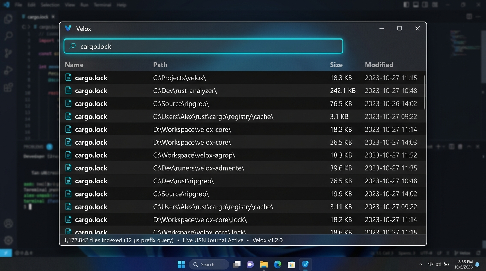

<div align="center">


# Velox

**Instant, microsecond file-name search engine and native GUI for Windows**

*Sub-microsecond prefix lookups powered by direct NTFS Master File Table parsing and real-time USN Change Journal streaming.*

<p>
  <a href="LICENSE"></a>
  
  
  
  
  
</p>

---

<p>
  <a href="#-about-velox">About</a> •
  <a href="#-key-features">Features</a> •
  <a href="#-visual-tour">Visual Tour</a> •
  <a href="#-measured-performance">Performance</a> •
  <a href="#-query-syntax--shortcuts">Query Syntax</a> •
  <a href="#-getting-started">Getting Started</a> •
  <a href="#-cli-reference">CLI</a> •
  <a href="#-architecture--internals">Architecture</a> •
  <a href="#-icon--design-philosophy">Design</a> •
  <a href="#-scope--license">License</a>
</p>

<p align="center">
  
</p>

</div>

---

## ⚡ About Velox

**Velox** (*Latin for swift, rapid*) is an ultra-low-latency file-name search engine and desktop application built in Rust for Windows. 

Traditional desktop search engines rely on filesystem crawlers that perform recursive directory walks (`FindFirstFile` / `FindNextFile`), incurring a system call per folder and scattering reads across disk blocks. Velox bypasses this bottleneck entirely:

1. **Direct NTFS MFT Extraction**: Reads the raw `$MFT` sequentially in large aligned sector batches during startup, parsing over **200,000 file entries per second**.
2. **Compact Contiguous In-Memory Index**: Retains every filename, parent pointer, size, and timestamp in a struct-of-arrays layout sorted for prefix search. Prefix queries evaluate to a contiguous slice in **under 1 microsecond**.
3. **Live USN Change Journal Sync**: Keeps the index updated in real time via the NTFS Update Sequence Number (USN) Change Journal. Updates apply in **1.6–12 µs** without rescanning the disk.
4. **Hardware-Accelerated Virtualized GUI**: Custom Win32 and Direct2D/DirectWrite interface rendering only visible screen cells. Zero UI hitching across millions of search results.

---

## ✨ Key Features

<table>
  <tr>
    <td width="50%">
      <h3>⚡ Sub-Microsecond Prefix Lookups</h3>
      <p>Prefix searches execute via binary search over a pre-sorted index. Match count calculation is O(1) and contiguous — results are never redundantly allocated or copied into memory.</p>
    </td>
    <td width="50%">
      <h3>🔄 Zero-Rescan Live Updates</h3>
      <p>Listens directly to the NTFS USN Change Journal. New files, deletions, and renames apply to a lock-free delta overlay in 1.6–12 µs without re-reading the filesystem.</p>
    </td>
  </tr>
  <tr>
    <td width="50%">
      <h3>🖥️ Virtualized Direct2D Interface</h3>
      <p>Custom Win32 renderer with DirectWrite typography. Only row items visible on your monitor are drawn each frame, handling millions of files with silky-smooth scrolling.</p>
    </td>
    <td width="50%">
      <h3>🔎 Rich Expressive Query Syntax</h3>
      <p>Supports boolean logic (<code>foo bar</code>, <code>foo | bar</code>, <code>!foo</code>), wildcards (<code>*.rs</code>), quoted phrases, extensions (<code>ext:rs;md</code>), size limits, date ranges, and fast in-place re-sorting.</p>
    </td>
  </tr>
  <tr>
    <td width="50%">
      <h3>🛡️ Graceful Permission Routing</h3>
      <p>No mandatory elevation. Fast-path MFT parsing activates when run as Administrator; unelevated sessions seamlessly degrade to a user-profile directory walk.</p>
    </td>
    <td width="50%">
      <h3>🔒 100% Offline &amp; Private</h3>
      <p>Strictly local-first. Contains zero telemetry, zero background network calls, and zero external tracking. What is on your machine stays on your machine.</p>
    </td>
  </tr>
</table>

---

## 📸 Visual Tour

### 1. Instant Keystroke Search
Results populate in real time as you type, with instantaneous response times down to nanoseconds.

<p align="center">
  
</p>

### 2. High-Performance Diagnostic CLI
Inspect volume indexing throughput, benchmark prefix latencies across synthetic corpora, or run interactive per-keystroke REPL profiling.

```
$ velox-cli repl
[build] indexed 1,177,842 entries in 5.44s (216,503 entries/sec)
query> car
  prefix "car" -> 14,892 matches (plan: Prefix, time: 520 ns)
query> cargo
  prefix "cargo" -> 3,211 matches (plan: Prefix, time: 540 ns)
query> cargo.lock
  prefix "cargo.lock" -> 42 matches (plan: Prefix, time: 480 ns)
```

---

## 📊 Measured Performance

### Synthetic Corpora (Release Build, Single Volume)

| Corpus Size | Prefix Query (Median) | P99 Latency | Resident Memory |
|:---|:---:|:---:|:---:|
| **100,000 entries** | 400 ns | 500 ns | 5.5 MB |
| **1,000,000 entries** | 500 ns | 700 ns | 52.6 MB |
| **5,000,000 entries** | 600 ns | 800 ns | 275.2 MB |

> [!NOTE]
> **Prefix latency remains virtually flat against corpus size.** A 50x larger corpus costs merely ~1.5x more per query, representing the purely mathematical $\mathcal{O}(\log_2 n)$ comparison term. Because the answer to a prefix query is a contiguous slice in the sorted array, match count is $\mathcal{O}(1)$ and results are streamed without materialization.

### Substring & Wildcard Narrowing

Substring and wildcard queries scan filtered candidates. Velox leverages incremental narrowing while typing:

| Typing `report` on 1,000,000 entries | Total Keystroke Time |
|:---|:---:|
| **With incremental narrowing (Velox)** | **54 ms** |
| Without narrowing (full rescan each keystroke) | 102 ms |

*(On a 5,000,000 entry corpus, narrowing achieves 470 ms vs 969 ms).*

### Live Benchmark on Real NTFS Volumes

Measured on a production machine with two NTFS volumes:

| Target Volume | File & Folder Entries | Elapsed Time | Indexing Throughput |
|:---|:---:|:---:|:---:|
| `C:` raw MFT read | 1,158,111 | 5.44 s | 212,888 entries/sec |
| `D:` raw MFT read | 19,731 | 0.66 s | 29,895 entries/sec |
| **Total** | **1,177,842** | **6.10 s** | **216,503 entries/sec** |

- **Live USN Journal Sync**: Batches of 2–55 records apply in **1.6–12 µs** each. Staying current costs strictly proportional to changed files, not the 1.18M entries indexed.
- **MFT vs. Win32 Directory Walking**: On `C:\Windows\System32` (19,754 entries), standard serial `FindFirstFile` takes 487 ms (40,548 entries/s). The raw MFT reader processes volume metadata **~5.3x faster** than serial enumeration.

### Real Volume Memory Breakdown

Measured on `C:` indexing 1,158,191 entries across 1,378,069 slots (**99.9 MB resident, 90.4 bytes/entry**):

| Memory Segment | Size (MB) | Proportion | Notes |
|:---|:---:|:---:|:---|
| **Packed name blob** | 53.8 MB | **54%** | Raw UTF-8 bytes packed without per-entry heap allocation |
| **Fixed per-slot arrays** | 40.0 MB | 40% | 29 bytes/slot (`parent`, `size`, `mtime`, `flags`, `offsets`) |
| **Sorted order array** | 4.6 MB | 5% | 4 bytes per entry (`u32` sorted index pointers) |

---

## 🔎 Query Syntax & Shortcuts

### Query Syntax

| Pattern | Description | Example |
|:---|:---|:---|
| `foo bar` | Implicit **AND** (both terms must match) | `cargo lock` |
| <code>foo &#124; bar</code> | Logical **OR** (either term matches) | <code>cargo &#124; rust</code> |
| `!foo` | Logical **NOT** (excludes matches) | `!temp` |
| `*.ext`, `test??.rs` | Wildcard patterns (`*` matches any, `?` matches single character) | `*.toml`, `test??.rs` |
| `"two words"` | Quoted exact phrase search | `"Release Notes"` |
| `ext:<extensions>` | Semicolon-delimited extension filter | `ext:rs;md;toml` |
| `size:<op><value>` | Size comparator (`>`, `<`, `>=`, `<=`, `kb`, `mb`, `gb`) | `size:>1mb`, `size:<10kb` |
| `dm:<op><date>` | Date modified comparator (`YYYY-MM-DD`) | `dm:>2026-01-01` |
| `file:` / `folder:` | Entry type restriction | `folder: target`, `file: .rs` |
| `sort:<field>-<order>` | Sort results without re-executing query plan | `sort:size-desc`, `sort:dm-asc` |

### Keyboard Shortcuts (GUI)

| Shortcut | Action |
|:---|:---|
| <kbd>F2</kbd> | Toggle between **Prefix** and **Substring** match modes |
| <kbd>F3</kbd> | Toggle between **Name only** and **Full Path** scope |
| <kbd>F5</kbd> | Rebuild volume index from scratch |
| <kbd>Enter</kbd> | Reveal selected file or folder in Windows File Explorer |
| <kbd>Up</kbd> / <kbd>Down</kbd> | Navigate through search results row-by-row |
| <kbd>Page Up</kbd> / <kbd>Page Down</kbd> | Scroll search results page-by-page |
| <kbd>Esc</kbd> | Clear current search query or close dialog |

---

## 🚀 Getting Started

### Prerequisites

- **Windows 10 / 11 (64-bit)**
- **Rust Toolchain**: 1.82+ stable (Rust 2021 Edition)
- **C++ Build Tools**: MSVC Desktop Development workload

### Compilation

Clone the repository and compile using Cargo:

```powershell
git clone https://github.com/nihil/velox.git
cd Velox

# Build optimized release binaries
cargo build --release
```

Binaries will be placed in `target\release\`:
- `Velox.exe` (Win32 + Direct2D GUI)
- `velox-cli.exe` (Diagnostic CLI & Benchmarks)

### Launching Velox

#### Launch GUI:
```powershell
cargo run --release -p velox-gui
# Or directly:
.\target\release\Velox.exe
```

#### Launch CLI:
```powershell
cargo run --release -p velox-cli -- repl
```

> [!TIP]
> ### Elevation Guidance
> Opening `\\.\C:` for raw volume reads requires administrator privileges.
> - **With Elevation (Recommended)**: Velox reads the MFT sequentially at 216k+ entries/sec and hooks live USN Change Journal updates.
> - **Without Elevation**: Velox runs without administrator rights by falling back to a `FindFirstFile` walk of your user profile (`%USERPROFILE%`), reporting its mode in the status bar. See [`docs/elevation.md`](docs/elevation.md).

---

## ⌨️ CLI Reference

The CLI utility is compiled as `velox-cli.exe` to prevent case-insensitive collisions with `Velox.exe` on Windows filesystems.

```powershell
# Build index over all local volumes and display detailed timings
velox-cli index

# Execute a one-off query and format output
velox-cli search "cargo.lock"

# Interactive REPL: Times each keystroke and displays active query plan
velox-cli repl

# Run synthetic latency benchmark across 100k, 1M, and 5M corpora
velox-cli bench [--quick]

# Compare raw MFT performance against naive serial & parallel walks
velox-cli compare "C:\Windows\System32"

# Monitor real-time USN Change Journal stream
velox-cli watch [--secs 10]
```

---

## 🏗️ Architecture & Internals

```
NTFS volume ──raw MFT read──┐
                            ├──> EntryStore  (Struct-of-Arrays, packed names)
non-NTFS ───FindFirstFile───┘         │
                                      v
                            VolumeIndex  (Sorted order + delta overlay)
                                      │
USN journal ──live updates───────────>│
                                      v
                                Searcher  (Prefix binary search,
                                           incremental narrowing)
```

The workspace is organized into modular crates:

```
crates/
  velox-core/   Engine library: MFT reader, USN journal, SoA store, query planner
  velox-cli/    velox-cli.exe — diagnostics, repl, benchmarks, comparison harness
  velox-gui/    Velox.exe — Win32 + Direct2D/DirectWrite virtualized GUI application
```

### Core Innovations

1. **`EntryId` as MFT Record Index**: MFT records are dense integer indices. Velox directly indexes internal slot arrays using the MFT record number, eliminating hash tables and allowing lock-free parallel build insertion.
2. **On-the-Fly Case Folding**: Filenames are stored once in their canonical case. Search comparisons perform branchless on-the-fly ASCII folding through a 256-byte table, saving ~110 MB of memory at 5M entries without measurable latency penalties.
3. **Delta Overlay for Journal Sync**: Rather than performing an expensive $\mathcal{O}(n)$ memory-move into the sorted array on every file change, new records append to a small $\mathcal{O}(1)$ delta buffer that is scanned alongside binary search.
4. **On-Demand Path Reconstruction**: Full folder paths are never stored per row. Paths are reconstructed on the fly by walking the parent index chain exclusively for visible rows on screen.

For an in-depth exploration, refer to [`docs/architecture.md`](docs/architecture.md).

---

## 🧪 Testing & Verification

Run the complete test suite across all workspace crates:

```powershell
cargo test --workspace
```

- **91 comprehensive tests** covering:
  - Synthetic byte-level MFT record parser with torn sector / fixup recovery.
  - USN change record decoder.
  - Zero-length attribute cycle protection.
  - DOS 8.3 vs. Win32 long filename priority resolution.
  - Negative and signed data-run extents.
  - Fallback non-elevated directory walks.

Run Criterion micro-benchmarks:

```powershell
cargo bench -p velox-core
```

---

## 🎨 Icon & Design Philosophy

<p align="center">
  
</p>

> *"An obsidian dark squircle illuminated by a sharp electric cyan chevron and radiant radar pulse — symbolizing microsecond speed, precision search, and continuous filesystem vigilance."*

- **Obsidian Foundation**: Represents the low-level, bare-metal stability of the Windows kernel and NTFS file structures.
- **Electric Cyan Chevron (`V`)**: Embodies rapid velocity, clean vector aerodynamics, and instant keystroke response.
- **Radar Pulse**: Signifies real-time active listening to the NTFS USN Change Journal, keeping the search state continuously synchronised.
- **High-DPI Contrast**: Engineered for immediate recognition and visual clarity across Windows Taskbar, Start Menu, and System Tray (16px to 256px).

---

## 📜 Scope & License

### Project Scope
Velox v1 focuses specifically on **instant filename and folder search**. It does not perform full-text file content indexing. Network shares and non-NTFS volumes utilize the directory walk fallback.

### License
Velox is open-source software licensed under the **[MIT License](LICENSE)**.

---

<div align="center">
  <sub>Built with precision and care for Windows power users.</sub>
</div>
